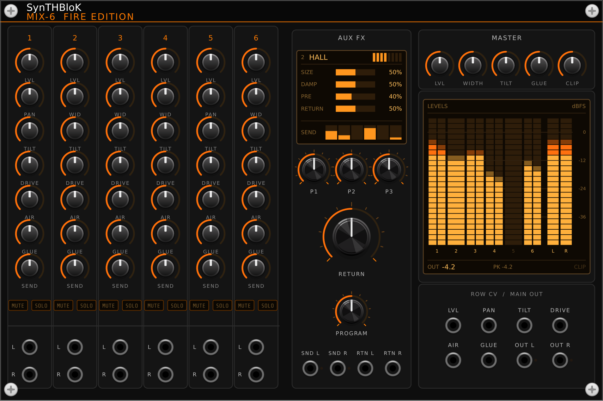
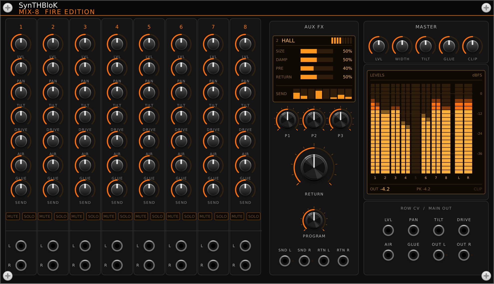
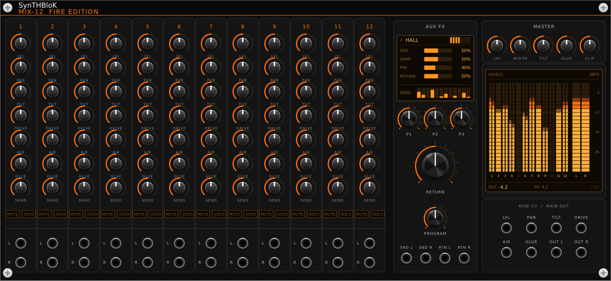

# SynTHBloK MIX Fire Edition

A free VCV Rack 2 plugin by **NoiZee ToyZ** (part of the SynTHBloK series).





| Module | What it does |
|---|---|
| **MIX-6 Fire Edition** | Six-channel stereo mixer with per-channel tilt, drive, air and glue, mute/solo, meters and an aux FX bus |
| **MIX-8 Fire Edition** | Eight-channel stereo mixer with per-channel tilt, drive, air and glue, mute/solo, meters and an aux FX bus |
| **MIX-12 Fire Edition** | Twelve-channel stereo mixer with per-channel tilt, drive, air and glue, mute/solo, meters and an aux FX bus |

## Install

In VCV Rack 2: **Library**, search **SynTHBloK MIX Fire Edition**, **Add**.

## Build

```
make RACK_DIR=/path/to/Rack-SDK   # or: make dist / make install
```

## Licence

GPL-3.0-or-later (see `LICENSE.txt`). The SynTHBloK and NoiZee ToyZ names and logos are not covered by the licence.
